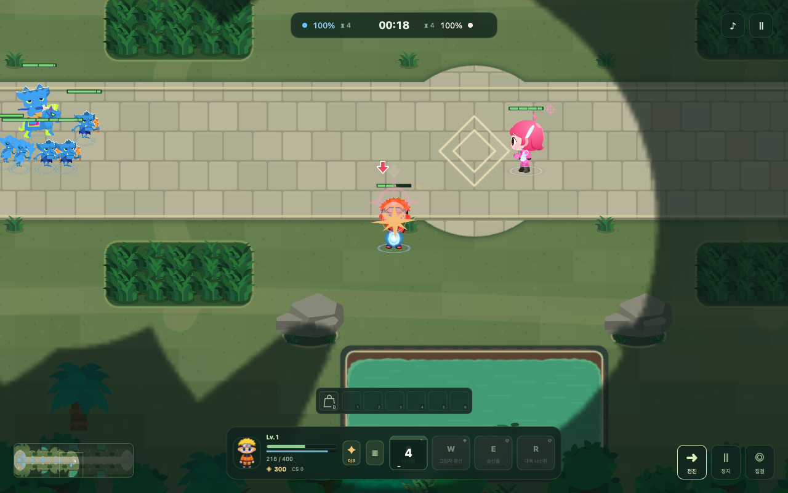
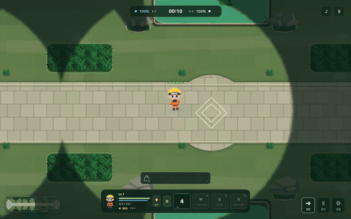
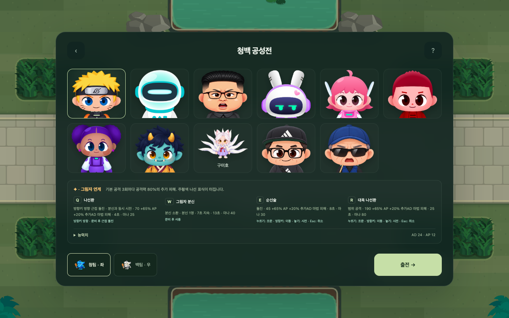
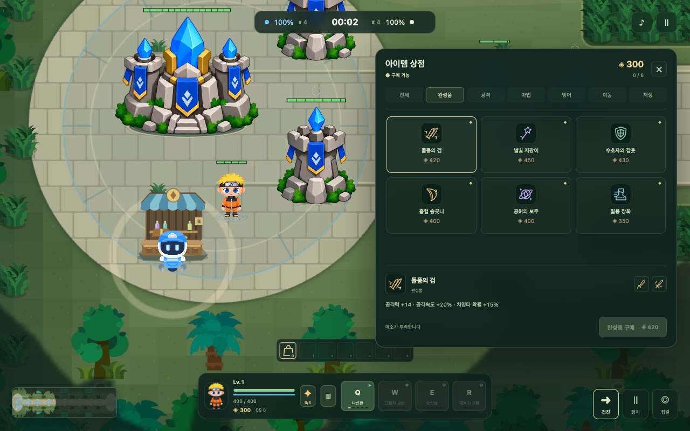

# 청백 공성전 · CODMOS Siege

캐릭터를 고르고 미니언과 함께 전진해 상대 넥서스를 파괴하는 **2D 횡방향 공성 게임**입니다. 청팀은 왼쪽, 백팀은 오른쪽에서 출발하며, 현재는 **플레이어 대 AI**로 진행합니다.

- 캐릭터 11종의 고유 패시브와 Q/W/E/R, 최대 18레벨의 스킬 성장
- 근접·원거리·기마 미니언 웨이브, 포탑 → 억제기 → 기지 포탑 → 넥서스 공성
- 아군 시야와 수풀 은신, 방향별 스프라이트와 스킬 준비 동작
- 메소·막타·6칸 인벤토리, 넥서스 옆 상점과 재료·완성품 구매

## 화면과 플레이 영상

실제 게임을 로컬 브라우저에서 실행해 촬영한 화면입니다. 온라인 멀티플레이는 아직 구현되지 않았습니다.



**짧은 플레이 미리보기** — 이동, 미니언 전투와 스킬 사용 장면입니다.



[▶ 기본 플레이 영상 보기 · 약 43초, 무음 MP4](https://github.com/BoominKimLogibros/codmos-siege/raw/refs/heads/main/docs/media/gameplay.mp4) · [영상 파일 페이지](docs/media/gameplay.mp4)

영상은 캐릭터 선택 → 이동·대시 → 전투·스킬 사용 순서로 진행합니다. 게임 상태나 능력치를 바꾸지 않고 일반 조작으로 촬영했습니다. 위 GIF는 영상 일부이며, 전체 영상은 MP4 링크에서 볼 수 있습니다.

| 캐릭터 선택 | 아이템 상점 |
| --- | --- |
|  |  |

## 같이 만들어 주세요

**코드 구현뿐 아니라 기획·밸런스·아트·사용성 제안도 PR로 환영합니다.** 완성된 기능이 없어도 문서로 아이디어를 구체화해 제안할 수 있습니다.

- **캐릭터 기획**: 새 캐릭터, 역할·플레이 스타일, 패시브·Q/W/E/R, 성장과 약점
- **게임 기획**: 승리 조건, 전장·시야·수풀, 공성 규칙, 미니언·AI, 새 모드
- **아이템 기획**: 신규 아이템, 가격·재료 조합, 능력치·효과, 소비 아이템과 상점 개선
- **밸런스·표현**: 스킬 수치, 이동·공격 조작, 애니메이션·이펙트, UI·사운드·접근성
- **개발 개선**: 버그 수정, 성능, 테스트, 문서와 개발 도구

저장소를 **Fork → 브랜치에서 수정 → 본인 Fork에 push → 원본 main으로 PR**을 보내 주세요. 기획 제안은 [제안서 양식](docs/proposals/README.md)을 복사해 문서를 추가하면 됩니다. 구현 PR은 검증 결과를, 기획 PR은 목적·구체적인 규칙·예상 영향을 적어 주세요. 제안은 검토·논의 후 반영하며, PR 제출만으로 자동 적용되지는 않습니다.

캐릭터 제작은 [캐릭터 제작 가이드](docs/CHARACTER-CREATION.md)를 참고하세요. 나루토 샘플처럼 원본 리그 분석 → 부위별 이미지 제작 → atlas 조립 → 방향별 스프라이트 출력 → 게임 적용·검증까지 설명합니다. 바로 사용할 이미지 생성 요청 예시와 파일 검사 명령도 포함했습니다.

자세한 참여 절차는 [개발 참여 안내](CONTRIBUTING.md)를 참고하세요.

## 로컬 실행

Node.js 22 또는 24와 npm이 필요합니다.

```sh
npm ci
npm run dev
```

http://127.0.0.1:5197/ 또는 /survival.html을 엽니다.

## 조작

- 방향키 / 우클릭: 이동, 같은 방향키 두 번: 대시, S: 정지
- Q/W/E/R: 스킬. 범위 스킬은 누른 채 방향키로 조준하고 키를 놓아 시전, Esc로 조준 취소
- Ctrl+Q/W/E/R 또는 + 버튼: 스킬 강화 (최대 레벨 18)
- B: 상점. 아군 넥서스 옆 상점 근처에서 재료 또는 완성품 구매·판매
- 1~6: 인벤토리 소비 아이템, Esc: 일시정지

## 검증

```sh
npm test
npm run build
# 개발 서버 실행 중, 로컬 Chrome이 설치되어 있을 때
npm run test:browser
```

게임 엔진·렌더러는 src/survival, 런타임 에셋은 public/survival, 테스트는 scripts에 있습니다. 세부 규칙은 [게임 문서](docs/SURVIVAL.md), 참여 절차는 [CONTRIBUTING.md](CONTRIBUTING.md)를 참고하세요.

## 에셋

사용자 제공 Codmos 캐릭터·미니언·타일·이펙트 에셋을 포함합니다. 각 에셋 폴더의 manifest, USED.json 및 원본 메타데이터에 출처를 보관합니다. 이 저장소는 포함된 제3자 캐릭터 및 에셋에 별도의 재배포·상업 이용 권한을 부여하지 않습니다.
