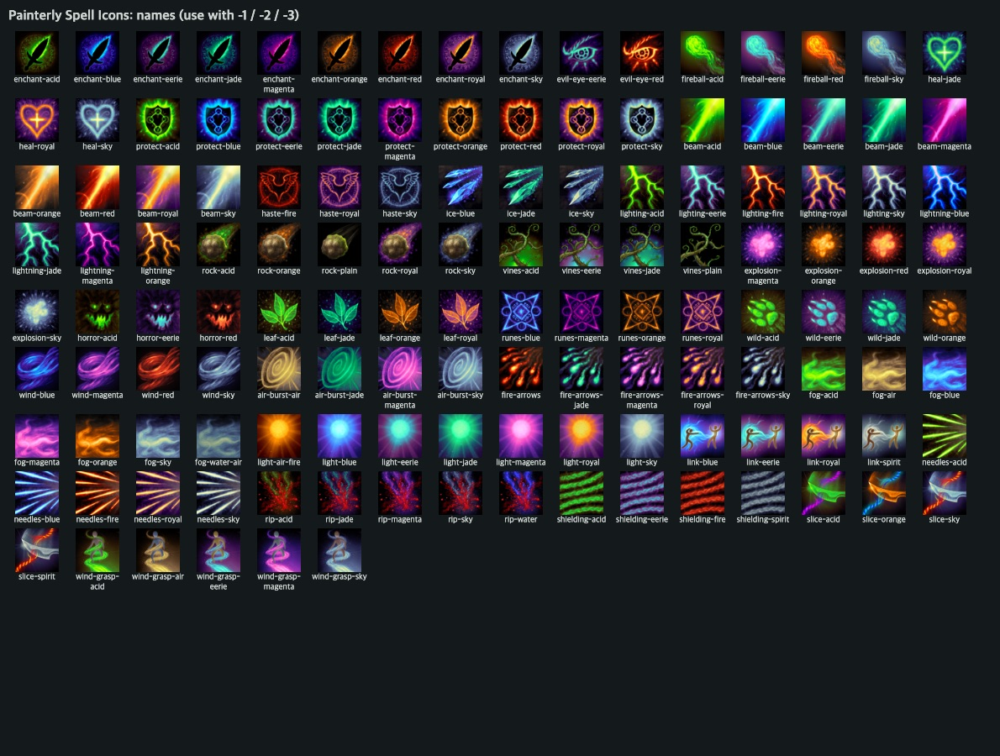
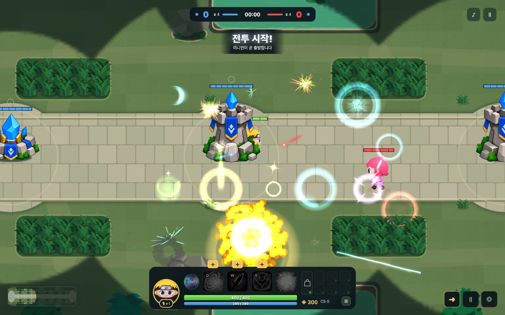
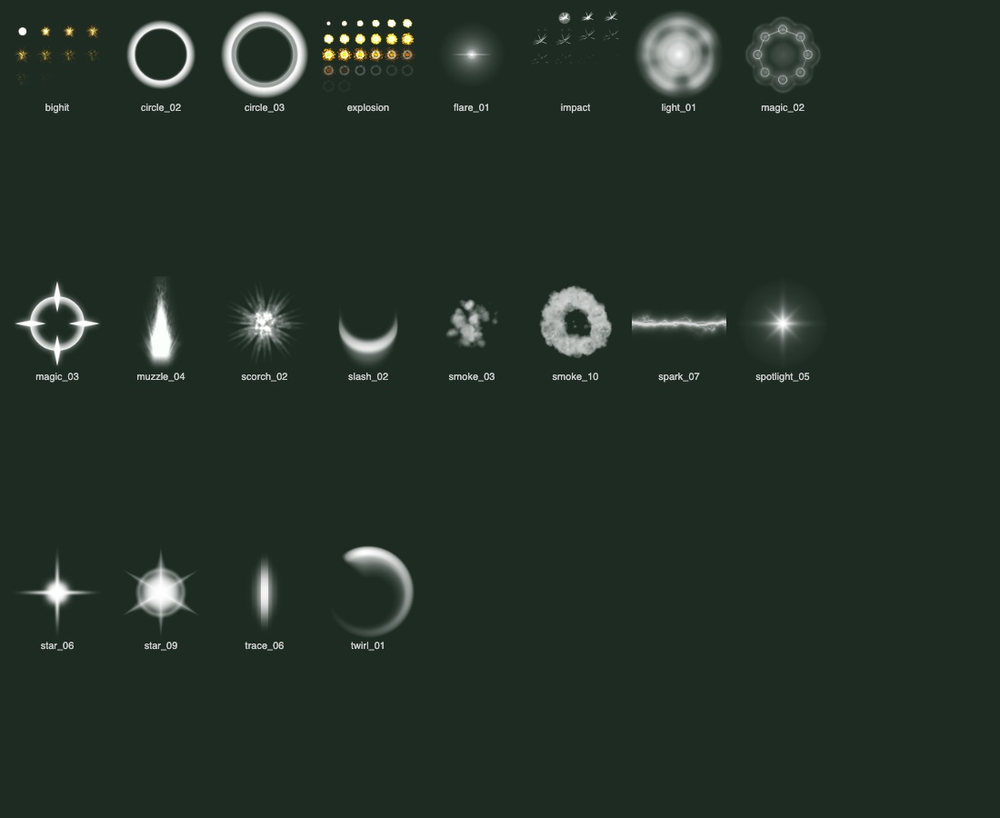
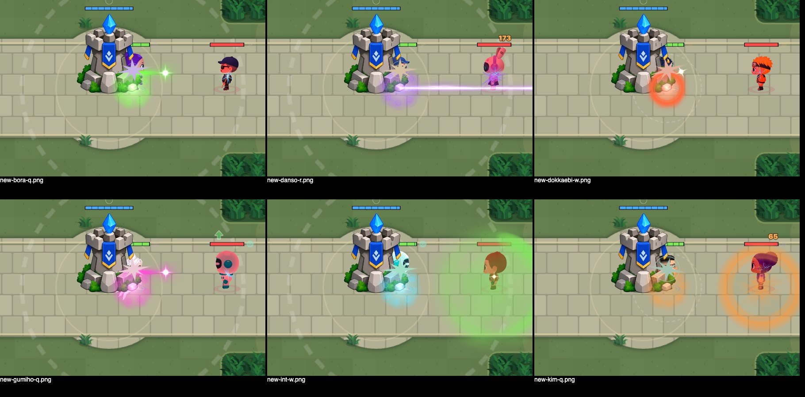

# 캐릭터 제작 가이드

**권장 제작 방식은 원하는 캐릭터를 설명받은 뒤, 우리 기본 Spine 47종 중 가장 어울리는 원형을 골라 이미지 파츠를 만들고, 그 Spine 데이터로 실제 움직임을 검수한 다음 스프라이트로 내려받아 사용하는 것입니다.** 나루토 샘플도 이 흐름으로 제작했습니다.

원하는 외형을 선택한 원형의 비율·파츠 구조·그림체에 맞춰 만들고, 기존 뼈대·메시·애니메이션을 재사용합니다. 외형만 만드는 아트 PR, 캐릭터 기획 PR, 게임에 연결하는 구현 PR 모두 가능합니다.

## 먼저 읽기: 우리가 권장하는 5단계

1. **원하는 캐릭터를 듣습니다.** 이름이나 설명, 참고 이미지로 체형·인상·복장·소품·성격을 파악합니다.
2. **기본 Spine 47종 중 어울리는 원형을 고릅니다.** 머리와 몸 비율, 실루엣, 팔다리 구조, 그림체와 기본 움직임을 비교해 가장 가까운 원형을 선택하고 이유를 남깁니다. 모든 캐릭터에 같은 스킨을 사용하지 않습니다.
3. **고른 원형과 비슷한 규격으로 이미지 파츠를 생성합니다.** 실제 원본의 머리·몸·팔·다리를 추출해 참고하고, 원하는 캐릭터의 특징을 입힙니다. 원형의 관절·부위 크기·메시 범위에 맞춰 원본 atlas 복사본에 배치합니다.
4. **그 Spine 데이터로 기본 움직임을 실제 재생합니다.** 정지·걷기·달리기·공격·방어와 방향 전환을 확인합니다. 잘리는 부분, 벌어지는 관절, 어색한 움직임이 있으면 파츠 이미지와 배치를 수정해 다시 확인합니다.
5. **검수를 통과하면 스프라이트로 내려받아 사용합니다.** 조립이 자연스럽고 잘림이 없어진 결과를 방향별·동작별 PNG 시트와 JSON으로 출력합니다. 로컬에 내려받아 보관하고 게임에서 재생합니다.

기본 Spine은 **캐릭터 제작과 동작 확인의 기준**, 스프라이트는 **게임에서 사용하는 결과물**입니다. 제작 단계에서 실제 움직임을 확인한 뒤 출력하는 순서를 권장합니다. 외형 샘플은 원하는 캐릭터 설명으로 시작할 수 있으며, 모든 능력치와 스킬 기획을 먼저 완성할 필요는 없습니다.

## 1. 전체 과정과 준비물

```text
원하는 캐릭터 설명·참고 이미지
 → 기본 Spine 47종 비교 → 어울리는 원형 선택
 → 원형의 파츠를 참고해 캐릭터 이미지 생성
 → 원형의 atlas 복사본에 배치
 → 해당 Spine 데이터로 실제 동작 재생
 → 잘림·관절·어색함 확인 ↔ 파츠 수정·재검수
 → 검수 통과 후 PNG 시트 + JSON 출력·다운로드
 → 내려받은 스프라이트를 게임에 적용
 → 스크린샷·영상과 함께 PR
```

나루토 제작에서는 원하는 외형에 맞는 원형으로 `codmos_jet`을 사용했습니다. 이는 해당 샘플의 선택이며, 다른 캐릭터를 만들 때는 기본 47종을 다시 비교해 어울리는 스킨을 고릅니다. 선택한 원형의 메시·UV·뼈대·관절·동작을 재사용합니다.

| 준비물 | 용도와 현재 저장소 상태 |
| --- | --- |
| 캐릭터 참고 이미지·기획 | 외형, 색상, 비율, 역할과 스킬을 정합니다. 직접 준비합니다. |
| 방향별 Spine skeleton JSON, atlas, atlas가 참조하는 모든 PNG | 외형 제작·원본 동작 렌더링에 필요합니다. 정면 참고본은 아래 경로에 있습니다. |
| 호환되는 Spine 런타임 또는 제작·내보내기 환경 | 원본 skeleton을 조립하고 애니메이션을 재생합니다. **이 게임의 npm 설치만으로 원본 제작 환경이 준비되지는 않습니다.** |
| 이미지 편집 도구 또는 이미지 생성 도구 | 투명 배경의 부위별 아트워크를 만듭니다. |
| Node.js 22/24, npm, 브라우저 | 내보낸 스프라이트 검사와 게임 실행에 사용합니다. |

참고 자료:

- [나루토 정면 원본 JSON](../public/survival/characters/naruto/front.json), [atlas](../public/survival/characters/naruto/front.atlas): 메시·애니메이션과 교체된 페이지의 구조
- [원본 정면 참고 폴더](../public/survival/characters/original), [나루토 정면 참고 폴더](../public/survival/characters/naruto)
- [나루토 게임용 스프라이트](../public/survival/character-sprites/naruto), [패키지 규격](../public/survival/character-sprites/README.txt), [공격·방어 규격](../public/survival/character-sprites/ATTACK-DEFEND-README.txt)

이 저장소에는 예전 제작 작업의 전체 exporter, 정면·후면·측면의 모든 Spine 제작 원본, 원본 `int_skn.ts` 프로젝트가 함께 배포되어 있지 않습니다. 정면 참고 JSON에는 `attack`·`defend`도 없습니다. 따라서 **정면 참고본만으로 모든 방향과 공격·방어를 재출력할 수는 없습니다.** 원본과 호환되는 제작 환경·방향별 소스·공격/방어 동작 소스를 별도로 확보하거나, 이미 내보낸 PNG·JSON 형식으로 작업해 주세요. 사용할 원본이 없으면 먼저 기획·아트 PR에서 필요한 자료를 적어 주세요.

제작 방식의 배경은 [나루토 에셋 샘플 만들기 채팅](codex://threads/01a17780-f290-7982-95ff-7e79b50cd73a)입니다. 이 채팅은 공개 개발자의 접근을 전제로 하지 않으며, 필요한 규격과 절차는 이 문서에 정리했습니다.

## 2. 캐릭터 기획 먼저 정하기

[기획 제안서](proposals/README.md)를 복사해 `docs/proposals/<캐릭터-id>.md`를 만듭니다.

- 고유 id: 영문 소문자와 하이픈 권장. 예: `forest-guardian`
- 이름, 역할, 주요 색상, 체형·복장·상징물
- 근접/원거리 기본 공격, 강점과 상대의 대응 방법
- 패시브와 Q/W/E/R: 효과, 입력 방식, 준비 동작, 자원 소모, 재사용 대기시간
- 체력·5초 재생·공격력·공격속도·주문력·방어력·마법저항력과 성장 방향
- 참고 이미지와 출처, 추가로 필요한 에셋

**외형 교체와 신규 챔피언 추가는 범위가 다릅니다.** 외형 교체는 기존 id·스킬을 유지할 수 있습니다. 신규 챔피언은 별도 id와 능력치·패시브·스킬 구현까지 연결해야 합니다. 기획만 제안한다면 아래 구현 과정을 전부 완료할 필요는 없습니다.

## 3. 기본 47종에서 원형 선택 후 atlas 분석

### 원하는 캐릭터에 어울리는 원형 고르기

기본 47종은 원래 제공된 스킨이며, 나루토 등 추가 제작 캐릭터 6종을 합친 53종과 구분합니다. [패키지 manifest](../public/survival/character-sprites/manifest.json)의 `characters` 목록에서 `key: "original"`인 항목으로 기본 후보를 확인할 수 있습니다. 이 목록에 있다고 모든 방향의 제작 원본이 이 저장소에 포함된 것은 아닙니다. 원본 확보 범위는 1절의 준비물을 확인하세요.

가능하면 원본 미리보기에서 후보의 정면·측면·후면과 동작을 직접 비교합니다. 기본 47종이 후보군이며, 게임 선택 화면의 11종에만 한정해 고르지 않습니다.

| 비교 기준 | 확인할 내용 |
| --- | --- |
| 체형·실루엣 | 원하는 캐릭터와 머리/몸 비율, 몸통·팔다리 길이와 폭이 가까운가? |
| 파츠·메시 | 머리카락·귀·복장·소품이 들어갈 공간이 있고 UV 범위에 맞추기 쉬운가? |
| 그림체 | 둥근 형태·명암·얼굴 표현이 원하는 스타일과 어울리는가? |
| 기본 움직임 | 걷기·달리기·공격·방어에서 원하는 인상이 유지되고 관절이 자연스러운가? |
| 제작 소스 | 필요한 방향과 동작의 skeleton·atlas·PNG를 확보할 수 있는가? |

잘 맞는 후보 2~3개를 추려 선택 이유와 예상 수정량을 비교한 뒤 하나를 기준으로 정하는 것을 권장합니다. 다음과 같이 선택 기록을 남겨 주세요.

```text
원하는 캐릭터: [이름 / 체형 / 복장 / 인상 / 소품]
비교 후보: [스킨 A, 스킨 B, 스킨 C]
선택한 기본 스킨: [스킨 id]
선택 이유: [비율·그림체·파츠 구조·동작 중 잘 맞는 점]
수정할 파츠: [머리, 몸통, 양팔, 양다리, 추가 소품]
확보한 원본: [방향별 skeleton / atlas / PNG / 동작 목록]
```

### 선택한 원형의 구조 분석

처음에는 정면의 `idle`·`move`만 검증하는 작은 샘플부터 시작하세요. 이후 후면과 좌우, 전투 동작으로 확장합니다.

1. JSON에서 앞서 선택한 기준 스킨을 찾습니다. 나루토 샘플은 `codmos_jet`을 사용했지만, 새 캐릭터는 선택한 원형의 스킨 id를 사용합니다. `basic`과 `codmos_jet`은 다른 메시이므로 서로 같은 부위 규격이라고 가정하지 마세요.
2. 스킨의 slot·attachment 이름과 연결된 bone, mesh UV와 외곽을 기록합니다. 보통 `head`, `body`, `arm_l`, `arm_r`, `leg_l`, `leg_r`가 있고, 캐릭터별로 추가 부위가 있을 수 있습니다.
3. atlas에서 attachment에 대응하는 region 이름, page PNG, `xy`, `size`, `rotate`, `orig`, `offset`을 확인합니다.
4. PNG에서 각 region을 추출하고, 사람이 이해하기 쉬운 정방향으로 돌려 머리·몸·팔다리의 원래 그림을 확인합니다.
5. 원본 캐릭터도 런타임으로 조립해 추출한 그림의 위아래와 좌우가 맞는지 비교합니다.

### 회전된 region 주의

기존 샘플의 legacy Spine 3.8 atlas에서는 `rotate: true`인 region이 페이지에서 **height × width** 공간을 차지합니다. 해당 형식에서 원래 방향으로 꺼낼 때 PIL의 `ROTATE_270`, 다시 넣을 때 `ROTATE_90`을 사용했습니다. 이는 모든 atlas 버전의 공통 규칙이 아닙니다. 원본 부위를 추출했다가 그대로 다시 넣는 왕복 검증으로 실제 방향을 먼저 확인하세요.

atlas 전체를 다시 그리면 다른 스킨과 공용 이펙트까지 바뀔 수 있습니다. **페이지 복사본에서 선택한 캐릭터의 region만 변경**하고, 원본 page 크기·region 좌표·padding·투명 영역은 유지합니다.

## 4. 부위별 이미지 제작

선택한 원형의 실제 파츠를 추출해 참고 이미지로 제공합니다. 원하는 캐릭터의 고유 요소를 넣으면서 **선택한 원형과 비슷한 그림체·부위별 크기·비율·관절 위치**로 생성합니다. 나루토 샘플에서는 둥근 형태와 부드러운 명암을 맞췄으며, 새 캐릭터는 자신이 고른 원형을 기준으로 판단합니다.

| 부위 | 작업 시 확인할 내용 |
| --- | --- |
| 머리 | 얼굴 방향, 눈 위치, 턱·귀·머리카락이 실제 mesh UV 외곽 안에 들어가는지 |
| 몸통 | 목과 허리 연결점, 팔과 중복되지 않는 어깨, 양팔을 벌려도 보이는 옷의 안쪽 |
| 좌우 팔 | 어깨가 위, 손이 아래인지, 좌우 부위를 뒤바꾸지 않았는지, 몸통과 분리되어 있는지 |
| 좌우 다리 | 허리가 위, 발이 아래인지, 무릎·발목 회전에도 관절이 이어지는지 |
| 소품 | 손의 bone/slot에 연결할지, 고정 그림인지. 공중에 떠다니거나 손을 관통하지 않는지 |

부위 그림은 atlas 사각형에 들어가더라도 메시 밖으로 나가면 잘립니다. 특히 볼·귀·머리카락은 UV 외곽과 약간의 여백을 두고 맞추세요. 목·어깨·허리 연결부는 동작에서 벌어지지 않도록 겹침을 확보합니다.

이미지 생성 결과를 균등한 격자로만 잘라 쓰지 마세요. 턱이나 머리카락이 예상 칸 아래로 이어질 수 있습니다. 투명한 간격을 기준으로 부위 전체를 분리하고, 완성된 머리와 팔다리를 확인한 뒤 원래 region에 맞춥니다. 영역 밖의 작은 얼룩이나 불필요한 픽셀도 제거합니다.

### 제작 전체를 요청하는 프롬프트 예시

```text
[원하는 캐릭터 설명 또는 참고 이미지]로 우리 게임용 캐릭터를 만들어줘.

먼저 우리 기본 Spine 47종을 비교해서 가장 어울리는 원형을 골라줘.
체형, 머리·몸 비율, 파츠 구조, 그림체와 기본 동작을 보고 선택 이유를 설명해줘.
나루토 샘플이 codmos_jet을 썼다고 무조건 같은 스킨을 고르지는 마.

선택한 원형의 실제 이미지 파츠를 참고해서, 원래 크기·관절·UV 범위에 맞는
머리·몸·양팔·양다리 이미지를 원하는 캐릭터 외형으로 생성해줘.
원형의 Spine 뼈대·메시·애니메이션을 유지해서 조립해줘.

그 Spine 데이터로 정지·걷기·달리기·공격·방어와 방향 전환을 실제로 재생해줘.
잘리는 부분, 목이나 팔다리 틈, 어색한 동작이 있으면 수정하고 다시 확인해줘.
문제가 해결되면 방향별·동작별 PNG 스프라이트 시트와 JSON으로 출력하고
로컬에서 내려받아 사용할 수 있게 캐릭터 폴더와 ZIP으로 정리해줘.
기준 스킨, 출력 설정, 포함한 동작, 확인 결과와 미완료 범위도 기록해줘.
제작 원본이나 도구가 없으면 알려주고 실제 검증 없이 완료했다고 하지 마.
```

### 이미지 생성 요청 예시

추출한 정방향 부위 이미지와 캐릭터 참고 그림을 함께 제공하고, 아래처럼 요청할 수 있습니다. `[ ]` 부분을 바꿔 사용하세요.

```text
첨부한 원본 Codmos 캐릭터의 부위 배치를 기준으로 [캐릭터 이름] 외형을 제작해줘.
부드러운 명암과 둥근 형태, 큰 머리와 작은 몸의 비율을 유지해줘.

머리, 몸통, 왼팔, 오른팔, 왼다리, 오른다리를 각각 분리하고 배경은 투명하게 해줘.
원본의 각 부위 크기, 방향, 관절 연결 위치와 실루엣 범위를 기준으로 만들어줘.
팔은 어깨가 위/손이 아래, 다리는 허리가 위/발이 아래 방향으로 그려줘.
머리의 턱, 귀, 머리카락이 원본 mesh UV 외곽에서 잘리지 않도록 해줘.
팔을 몸통에 합쳐 그리지 말고, 다른 부위나 장식이 인접 영역을 침범하지 않게 해줘.

캐릭터 특징: [복장, 머리 모양, 표정, 주조색, 소품]
이번 작업 방향: [정면 / 후면 / 측면]
```

생성 도구가 지정한 픽셀 크기나 관절 위치를 정확히 지킨다고 가정하지 마세요. 최종 크기 맞춤과 투명 영역 정리는 편집 도구에서 하고, 반드시 조립 결과를 확인합니다. 후면은 얼굴을 그대로 복사하지 말고 뒤통수·복장·소품 위치를 따로 설계합니다.

## 5. atlas 재배치와 조립 검수

1. 새 부위를 원래 region의 크기와 방향에 맞춰 페이지 복사본에 넣습니다. 회전 region은 원본 방식대로 회전해 배치합니다.
2. 새 atlas가 새 PNG를 참조하도록 합니다. 다른 스킨이나 원본 JSON을 덮어쓰지 않습니다.
3. 호환 런타임에서 해당 스킨을 선택하고 setup pose를 적용한 뒤 원래 스케일로 재생합니다. 원본 skeleton의 버전 문자열만 임의로 고쳐 호환성을 해결하려 하지 마세요.
4. `idle → move → idle`, 팔이 크게 벌어지는 장면, 다리 회전, `attack`, `defend`, `failure`, `success`를 확인합니다.
5. 머리 잘림, 목 틈, 분리된 팔·다리, 손과 소품의 미끄러짐, 페이지 로드 실패를 확인합니다.
6. 얼굴 비율이 바뀌면 실패 동작의 눈물이나 표정 이펙트가 눈과 맞는지 확인합니다. 필요할 때는 **해당 캐릭터의 별도 JSON**에서 관련 키프레임만 조정하고 다른 스킨에 영향을 주지 않습니다.

정면이 정상이라고 후면·측면이 자동으로 완성되지는 않습니다. 각 방향을 해당 원본으로 조립해 같은 과정을 거칩니다. 한 방향만 완성했다면 PR에도 그 범위를 명시하세요.

## 6. 검수한 결과를 스프라이트로 출력·다운로드하기

5절에서 실제 움직임을 확인해 **잘림과 어색한 연결이 해소된 결과**를 출력합니다. 문제가 남아 있으면 파츠 수정과 Spine 재생 검수를 먼저 반복합니다.

방향별·동작별 PNG 시트와 JSON을 캐릭터 폴더로 묶어 로컬에 내려받아 보관합니다. 전달할 때는 ZIP으로 묶고, 기준 스킨 id·제작 원본·fps·scale·포함된 방향과 동작·검수 결과를 README에 기록합니다. 가능하면 동작 미리보기도 함께 전달합니다. 다운로드한 결과를 게임의 스프라이트 폴더에 넣고 파일 검사와 실제 플레이를 확인하는 방식을 권장합니다.

현재 게임은 Spine skeleton을 직접 재생하지 않고, [CharacterCast](../src/survival/characters.js)와 [SpritePlayer](../src/survival/sprite-player.js)가 **동작별 PNG 시트 + hash-frame JSON**을 읽습니다.

### 필요한 파일: 캐릭터당 20쌍

| 방향 | 필수 동작 |
| --- | --- |
| `front` | `idle`, `move`, `attack`, `defend`, `failure`, `success` |
| `back` | `idle`, `move`, `attack`, `defend` |
| `side_left` | `idle`, `move`, `attack`, `defend`, `run` |
| `side_right` | `idle`, `move`, `attack`, `defend`, `run` |

```text
public/survival/character-sprites/forest-guardian/
  front/idle.png + idle.json
  front/move.png + move.json
  front/attack.png + attack.json
  front/defend.png + defend.json
  front/failure.png + failure.json
  front/success.png + success.json
  back/...             # 위 표의 4동작
  side_left/...        # 위 표의 5동작
  side_right/...       # 위 표의 5동작
```

위 예시의 `forest-guardian`은 새 캐릭터 폴더명입니다. 후면은 위쪽 이동, 정면은 아래쪽 이동에 대응합니다. 상하 대시는 `move`를 빠르게 재생하고, 좌우 대시는 `run`을 사용합니다. 좌측 시트는 이미 반전된 그림을 저장하며, 현재 캐릭터 렌더러는 추가 flip을 하지 않습니다. 비대칭 소품은 단순 반전으로 적절한지 별도 검토합니다.

### 기존 내보내기 방식

다음은 원래 샘플의 내보내기 알고리즘입니다. 저장소에 바로 실행할 수 있는 Spine exporter 명령이 있다는 의미는 아닙니다. 호환되는 제작 도구로 같은 결과 형식을 만들어 주세요.

1. 실제 Spine 런타임에서 원하는 스킨·방향·애니메이션을 선택하고 RGBA 투명 캔버스에 렌더링합니다. 기존 기준은 원본 scale `0.4`, `24fps`입니다.
2. 애니메이션 길이가 `duration`초이면 `ceil(duration × 24)`개 프레임을 `i / 24`초에서 샘플링합니다. 마지막 프레임은 원래 동작 길이에 맞춰 짧아질 수 있습니다.
3. 한 동작의 **모든 프레임에 보이는 영역의 합집합**을 구하고 여백을 더해 같은 크기로 잘라냅니다. 프레임마다 다른 크기로 자르면 현재 로더의 고정 anchor와 맞지 않을 수 있습니다.
4. 고정된 Spine 루트에서 crop 원점을 빼 `meta.anchor`를 계산합니다. 각 프레임의 실제 발 위치로 anchor를 다시 계산하면 안 됩니다. 루트 기준점을 유지해야 동작 전환 시 캐릭터가 튀지 않습니다.
5. 기존 패키지는 프레임 바깥에 1px씩, 인접 프레임 사이에 합계 2px의 투명 간격을 둡니다. 예: `x = column × (frameWidth + 2) + 1`. 그리드 크기를 추정하지 말고 JSON에 정확한 사각형을 기록합니다.
6. 각 프레임의 정수 ms 길이는 `round((i+1) × 1000/24) − round(i × 1000/24)`로 계산합니다. 마지막 프레임은 전체 ms에서 앞 프레임들의 합을 뺍니다. 합계가 원래 동작 길이와 일치해야 합니다.
7. PNG와 JSON을 같은 동작 이름으로 저장하고 `meta.image`에 PNG 파일명을 기록합니다.

기존 공격은 **850ms / 21프레임**, 방어는 **1200ms / 29프레임**입니다. 현재 게임의 제스처 시간도 이에 맞춰져 있습니다. 다른 길이를 사용할 경우 이미지뿐 아니라 [skill-cast.js](../src/survival/skill-cast.js)와 전투 동작의 시간 처리도 함께 검토해야 합니다.

### JSON 예시: 기존 나루토 front/attack의 첫 프레임

아래는 구조를 설명하는 **축약본**입니다. 복사해서 완성된 21프레임 파일로 사용할 수는 없습니다. 전체 예시는 [attack.json](../public/survival/character-sprites/naruto/front/attack.json)을 참고하세요.

```json
{
  "frames": {
    "attack_000": {
      "frame": {"x": 1, "y": 1, "w": 200, "h": 278},
      "rotated": false,
      "trimmed": false,
      "spriteSourceSize": {"x": 0, "y": 0, "w": 200, "h": 278},
      "sourceSize": {"w": 200, "h": 278},
      "duration": 42,
      "pivot": {"x": 0.495, "y": 0.9244604316546763}
    }
  },
  "meta": {
    "image": "attack.png",
    "size": {"w": 1616, "h": 840},
    "scale": "0.4",
    "fps": 24,
    "durationMs": 850,
    "frameCount": 21,
    "animation": "attack",
    "direction": "front",
    "anchor": {"x": 99, "y": 257},
    "loop": false
  }
}
```

`frames`의 등록 순서가 재생 순서입니다. `duration`은 ms이며 양수여야 합니다. 현재 로더는 `meta.anchor`를 사용하므로 프레임별 `pivot`만 저장해서는 안 됩니다. `anchor`는 시트 전체가 아닌 **개별 프레임 좌상단 기준의 루트 좌표**입니다. 여백·원본 루트에 따라 프레임 밖에 있을 수도 있으므로 강제로 중앙에 맞추지 마세요.

`attack`, `defend`, `failure`, `success`는 `loop:false`, `idle`, `move`, `run`은 반복을 권장합니다. 시트 전체를 한 캐릭터 그림으로 그리지 않습니다.

## 7. 새 캐릭터를 게임에 연결하기

외형 교체만 하는 경우 기존 폴더 규격을 유지하고 아트·메타데이터 변경 범위를 설명합니다. 신규 캐릭터는 아래 연결 지점을 확인해야 합니다. **PNG를 추가하거나 HEROES에 한 줄 추가하는 것만으로 완성되지 않습니다.**

| 파일 | 연결할 내용 |
| --- | --- |
| [heroes.js](../src/survival/heroes.js) | 고유 id, 이름, 역할, 색상, 기본 hp/speed/damage/cooldown, 기본 공격 타입 등. 근접은 `knight`, 기존 원거리는 `witch` |
| [characters.js](../src/survival/characters.js) | `SPRITE_FOLDERS`에 id → 실제 스프라이트 폴더명 등록. 인트 id는 `int`, 폴더는 `basic`인 기존 예 참고 |
| [stats.js](../src/survival/stats.js) | `profiles`에 기본 재생·마나·주문력·방어·성장 등록. 배열 순서는 `hpRegen5, mana, manaRegen5, abilityPower, armor, magicResist, hpGrowth, attackSpeedGrowth` |
| [kits.js](../src/survival/kits.js) | 패시브 이름과 Q/W/E/R 정의, 입력 방식과 미리보기 도형. 아래 공통 루프가 부여하는 피해 타입·마나·계수도 검토 |
| [skill-levels.js](../src/survival/skill-levels.js) | 랭크별 피해·범위·인원·재사용 대기시간 등의 성장과 캐릭터별 예외 확인 |
| [passives.js](../src/survival/passives.js), [passive-art.js](../src/survival/passive-art.js) | 패시브 설명·아이콘·색·표식과 상태 계산. 새 표식 모양이 필요하면 렌더러도 추가 |
| [engine.js](../src/survival/engine.js) | 실제 패시브 발동과 새 스킬 종류의 효과, 기본 공격의 예외, AI 사용 조건. 설명 문구만 추가하면 효과가 생기지 않음 |
| [cast-effect-spec.js](../src/survival/cast-effect-spec.js), [skill-cast.js](../src/survival/skill-cast.js) | 캐릭터 색상·방향별 시전 이펙트, 공격/방어 준비 동작. 새 스킬 종류가 버프라면 지원 동작 분류 확인 |
| [asset-manifest.js](../src/survival/asset-manifest.js) | 패시브와 Q/W/E/R 스킬 아이콘 이름. 등록하지 않으면 이모지 아이콘이 대신 표시됨. 아래 8절 참고 |
| [테스트 폴더](../scripts) | 캐릭터 목록·에셋·스킬 분류 개수 등을 11종으로 가정하는 테스트를 검토하고 필요한 기대값·새 기능 검증 갱신 |

현재 `hero.hp`는 `statsAt`에서 4배가 되어 초기 최대 체력이 됩니다. 이동속도와 사거리는 UI에서 맵 단위의 50배로 표시합니다. 원래 수치와 UI 수치를 혼동하지 말고 [능력치 문서](CHAMPION-STATS.md)를 확인하세요. 공격속도는 기본 `cooldown`과 추가 간격을 사용해 계산됩니다.

스킬 입력은 `target`(사용 가능 대상에 즉시 시전 준비), `self`(자신에게 시전 준비), `aim`(keydown 조준·keyup 확정·Esc 취소), `direction`(방향키/마지막 방향, 나루토 Q 사례)을 구분합니다. 기존 [스킬 입력](SKILL-INPUT.md)과 [성장 규칙](SKILL-PROGRESSION.md)을 따릅니다.

공격·버프는 준비 제스처를 보여준 뒤 실제 효과를 발동합니다. 기본 공격도 공격속도에 맞춰 제스처가 재생됩니다. 이동/대시 중 평타는 발생하지 않고, 공격·스킬 제스처 중 이동은 잠깐 멈춥니다. 일반 피격은 tint로 표시하며 몸의 `HP_Down` 동작으로 전환하지 않습니다. 회복·특수 HP 변화 표시는 별도 이펙트입니다. 새 캐릭터도 이 동작 규칙을 유지해 주세요.

## 8. 스킬 아이콘과 전투 이펙트 정하기

스킬 칸, 툴팁, 일시정지 화면의 스킬 카드에는 그림 아이콘이 들어가고, 평타·스킬·피격·레벨 업 같은 전투 이펙트는 공용 텍스처로 그립니다. 새 캐릭터를 만들 때에는 **아이콘 5개(패시브, Q, W, E, R)를 고르고, 스킬이 어떤 이펙트로 보일지 확인**하면 됩니다. 이펙트는 스킬 종류와 팀 색으로 자동 결정되므로, 대부분은 새 그림을 만들 필요가 없습니다.

### 스킬 아이콘 고르기

스킬 아이콘은 J. W. Bjerk(eleazzaar)의 [Painterly Spell Icons](https://opengameart.org/content/painterly-spell-icons-part-1)(1~4부)에서 고릅니다. 아래 목록에서 스킬의 느낌과 캐릭터 색에 맞는 그림을 찾고, 이름을 적어 둡니다.



같은 그림은 빛의 세기에 따라 `-1`, `-2`, `-3` 세 장이 있습니다. 기존 캐릭터들은 다음 규칙을 따릅니다.

| 칸 | 세기 | 이유 |
| --- | --- | --- |
| 패시브 | `-1` | 상시 효과라서 가장 차분한 그림을 씁니다. |
| Q, W, E | `-2` | 기본 스킬의 표준 세기입니다. |
| R | `-3` | 궁극기가 한눈에 구분되도록 가장 화려한 그림을 씁니다. |

한 캐릭터 안에서는 색 계열(`sky`, `royal`, `acid` 등)을 한두 가지로 맞추고, 다른 캐릭터와 같은 그림·같은 색 조합은 피해 주세요. 지금 쓰는 조합은 [asset-manifest.js](../src/survival/asset-manifest.js)의 `SKILL_ICON_SOURCES`에서 확인할 수 있습니다.

### 아이콘 등록과 가져오기

1. [asset-manifest.js](../src/survival/asset-manifest.js)의 `SKILL_ICON_SOURCES`에 캐릭터 id로 한 줄을 추가합니다.

   ```js
   'forest-guardian':{p:'leaf-jade-1',q:'vines-jade-2',w:'heal-jade-2',e:'wind-grasp-acid-2',r:'wild-jade-3'},
   ```

2. 원본 팩 4개를 OpenGameArt에서 받아 한 폴더에 풀고, 가져오기 스크립트를 실행합니다. 개발 서버가 켜져 있지 않아도 동작합니다.

   ```sh
   node scripts/import-free-assets.mjs --painterly <압축을 푼 폴더> --only skills
   ```

3. 스크립트가 `public/survival/icons/skills/<캐릭터 id>-<p|q|w|e|r>.png`를 128px로 저장합니다. 이 PNG를 함께 커밋합니다.

`SKILL_ICON_SOURCES`에 캐릭터가 없으면 [skill-icons.js](../src/survival/skill-icons.js)에 정의된 스킬 종류별 이모지가 표시됩니다. 그래서 기획 단계에서는 아이콘 없이 먼저 플레이해 보고, 아트가 정해진 뒤에 등록해도 됩니다. 목록에 맞는 그림이 없어서 직접 그린 아이콘을 쓰려면, 같은 경로와 크기(128×128, 정사각형)로 PNG를 넣고 출처를 아래 '에셋 출처' 절에 적어 주세요.

### 전투 이펙트 확인하기

전투 이펙트는 Brackeys VFX Bundle(CC0)의 흰색 텍스처를 팀 색이나 효과 색으로 칠해서 겹쳐 그립니다. 엔진이 만드는 효과 종류(`effect.kind`)마다 모양이 정해져 있어서, 새 스킬이 기존 스킬 종류(`kind`)를 쓰면 이펙트도 자동으로 붙습니다.



| 효과 종류 | 언제 나오는가 | 모양 | 정의 위치 |
| --- | --- | --- | --- |
| `sigil` | 모든 스킬을 쓰는 순간 | 시전자 발밑에서 도는 마법진과 섬광 | [vfx.js](../src/survival/vfx.js) |
| `shield`, `poof` | 보호막·반사·회피 스킬, 분신 소환 | 방어막 고리와 별, 흰 연기 | [vfx.js](../src/survival/vfx.js) |
| `slash` | 근접 평타 | 공격 방향을 향한 초승달 베기. 치명타는 금색 섬광과 폭발이 더해집니다. | [combat-fx.js](../src/survival/combat-fx.js) |
| `hit` | 평타·투사체 명중 | 공격한 팀 색의 타격 플립북. 건물 피격은 더 큰 폭발이 더해집니다. | [combat-fx.js](../src/survival/combat-fx.js) |
| 투사체 | 원거리 평타, 포탑, 스킬 | 평타와 포탑은 팀 색의 작은 빛줄기, 스킬은 챔피언 색의 큰 빛 구슬 | [combat-fx.js](../src/survival/combat-fx.js) |
| `burst` | 범위 피해 스킬 | 퍼지는 충격파 고리, 그을음, 흰 섬광 | [vfx.js](../src/survival/vfx.js) |
| `zone` | 장판 스킬의 피해 주기 | 고리가 한 번 퍼집니다. 장판 자체는 천천히 도는 마법진으로 표시됩니다. | [vfx.js](../src/survival/vfx.js) |
| `heal`, `mana` | 회복 스킬, 물약 | 초록(마나는 파랑) 빛, 소용돌이, 떠오르는 별 | [vfx.js](../src/survival/vfx.js) |
| `buff` | 강화 스킬 | 도는 소용돌이와 고리 | [vfx.js](../src/survival/vfx.js) |
| `silence` | 침묵 스킬 | 보라색 룬과 고리 | [vfx.js](../src/survival/vfx.js) |
| `beam` | 광선 스킬 | 시작점과 끝점을 잇는 번개 줄기 | [vfx.js](../src/survival/vfx.js) |
| `dash` | 대시, 이동기 | 발밑 흙먼지 | [vfx.js](../src/survival/vfx.js) |
| `level`, `learn`, `purchase` | 레벨 업, 스킬 습득, 아이템 구매 | 금색 빛기둥, 별, 고리 | [vfx.js](../src/survival/vfx.js) |
| `death`, `collapse` | 챔피언 사망, 포탑 붕괴 | 연기와 타격 플립북, 큰 폭발 | [vfx.js](../src/survival/vfx.js) |

시전 직전에 캐릭터를 감싸는 시전 이펙트는 이와 별개입니다. 시전 이펙트의 색은 [cast-effect-spec.js](../src/survival/cast-effect-spec.js)에서 캐릭터 색으로 정합니다.

새 스킬 종류를 만들어서 기존 모양으로는 표현이 부족하다면, [vfx.js](../src/survival/vfx.js)의 `RECIPES`에 효과 종류를 하나 추가합니다. 레시피는 아래 텍스처를 몇 장 겹치고, 효과 수명(0에서 1)에 맞춰 크기·투명도·회전을 바꾸는 함수입니다. 쓸 수 있는 텍스처는 다음과 같습니다.



번들에 있는 다른 텍스처가 필요하면 [asset-manifest.js](../src/survival/asset-manifest.js)의 `VFX_PARTICLES`에 이름을 추가하고 가져오기 스크립트를 다시 실행합니다. 번들은 [itch.io 배포 페이지](https://brackeysgames.itch.io/brackeys-vfx-bundle)에서 0원으로 받을 수 있습니다.

```sh
node scripts/import-free-assets.mjs --vfx <brackeys_vfx_bundle 폴더> --only vfx
```

텍스처는 흰색이므로 색은 코드에서 정합니다. 평타·건물 피격처럼 팀을 구분해야 하는 효과는 팀 색(`TEAM_COLORS`)을 쓰고, 회복처럼 의미가 정해진 효과는 고정 색을 씁니다. **스킬에서 나온 효과는 챔피언 색**으로 칠합니다. 엔진은 스킬이 만든 효과에 시전자의 `heroId`를 붙이고, 화면에서는 [asset-manifest.js](../src/survival/asset-manifest.js)의 `SKILL_VFX_COLORS`에서 색을 찾습니다. 새 캐릭터는 스킬 아이콘의 색 계열과 어울리는 선명한 색을 한 줄 추가해 주세요. 항목이 없으면 `heroes.js`의 캐릭터 색을 쓰는데, 이 색은 옅은 파스텔 톤이라 이펙트가 흐리게 보입니다.

아래는 실제로 스킬을 썼을 때의 화면입니다. 왼쪽 위부터 보라 Q, 단소살인마 R, 도깨비 W, 구미호 Q, 인트 W, 김정은 Q입니다.



화면 확인은 실제 플레이에서 스킬을 써 보는 것이 가장 정확하며, 콘솔에 텍스처 로드 오류가 없는지도 함께 확인해 주세요.

### 에셋 출처

| 용도 | 에셋 | 라이선스 | 출처 표기 |
| --- | --- | --- | --- |
| 스킬·패시브 아이콘 | Painterly Spell Icons 1~4부, J. W. Bjerk (eleazzaar) | CC-BY 3.0 (선택 가능한 라이선스 중 하나) | 필요합니다. [에셋 출처](ASSET-CREDITS.md)에 기록되어 있습니다. |
| 아이템 아이콘 | 496 Pixel Art Icons for Medieval/Fantasy RPG, Henrique Lazarini (7Soul1) | CC0 | 필요 없지만 기록해 둡니다. |
| 전투 이펙트 | Brackeys VFX Bundle (Kenney, Picster, Thomas Iché, CodeManu) | CC0 | 필요 없지만 기록해 둡니다. |

다른 무료 에셋을 추가할 때에는 상업적 사용이 가능한지, 출처 표기 조건이 무엇인지 확인하고 [에셋 출처](ASSET-CREDITS.md)에 함께 적어 주세요.

## 9. 파일 검사와 실제 플레이 검수

```sh
npm ci
# 폴더명 기준. 실제 파일은 public/survival/character-sprites/<폴더명>에 둡니다.
npm run check:character -- forest-guardian
# 기존 캐릭터로 검사 명령을 확인하려면:
npm run check:character -- naruto
npm test
npm run build
npm run dev
```

`check:character`는 필수 20쌍, PNG 헤더 크기, 프레임 사각형·수·길이, 메타데이터와 반복 설정 등 **파일 구조**를 검사합니다. 그림의 잘림·관절·피벗의 시각적 정확성, PNG 전체 픽셀 무결성, 캐릭터 게임 등록 여부까지 보장하지는 않습니다.

실제 게임에서는 다음을 확인해 주세요.

- 네 방향 이동, 대각선 방향 전환, 멈춘 뒤 마지막 방향 유지
- 좌우 대시의 방향, 발 기준점, 좌우 반전이 두 번 적용되지 않는지
- 정지/이동/평타/스킬 사이에 위치나 크기가 튀지 않는지
- 공격·방어 준비 동작과 실제 효과 시점, 연속 평타와 빠른 공격속도
- 일반 피격 tint, 시전 이펙트 색상, 회복/피해 오버레이, HP 막대 위치
- 스킬 칸·툴팁·일시정지 화면의 아이콘, 스킬을 썼을 때의 전투 이펙트
- 사망/부활/승리, 일시정지/재개, 다른 캐릭터와 상대 팀일 때의 동작
- 콘솔 오류, 누락된 PNG·JSON 요청, 프레임이 비거나 화면 밖으로 잘리는 현상

## 10. PR에 포함할 내용

- **기획 PR**: 역할·외형·패시브·Q/W/E/R 기획, 필요한 원본과 미정 사항
- **아트 PR**: 부위별 원본/atlas 변경 내역 또는 게임용 PNG·JSON, 스킬 아이콘 선택, 제작·출처 기록, 정면/측면/후면 조립 결과, 짧은 동작 영상. 완료한 방향·동작 범위를 명시
- **구현 PR**: 위 에셋과 게임 연결 변경, 새 패시브·스킬 검증, 실제 플레이 화면과 테스트·빌드 결과

새 에셋의 출처·제작 방식·사용 범위, 기준 스킨과 내보내기 설정을 캐릭터 폴더의 별도 README나 출처 JSON에 기록하세요. 기존 전체 manifest는 원본 패키지 기록이므로 새 파일 하나를 추가했다고 전체를 재생성하거나 덮어쓰지 말고, 이번 변경의 사용 목록을 별도로 남겨 주세요.

[개발 참여 절차](../CONTRIBUTING.md)에 따라 Fork와 브랜치에서 작업하고 원본 `main`으로 PR을 보냅니다. 구현 전 기획만 제출해 범위를 먼저 논의해도 됩니다.
