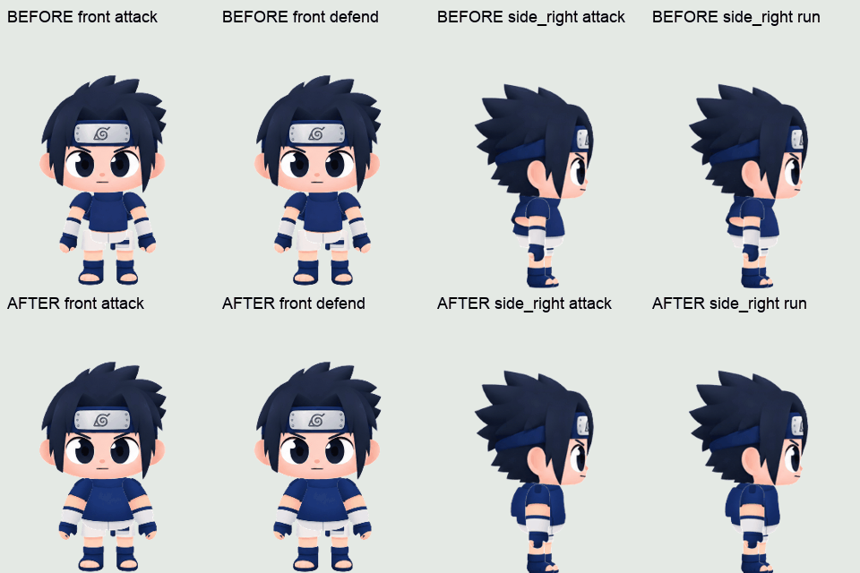
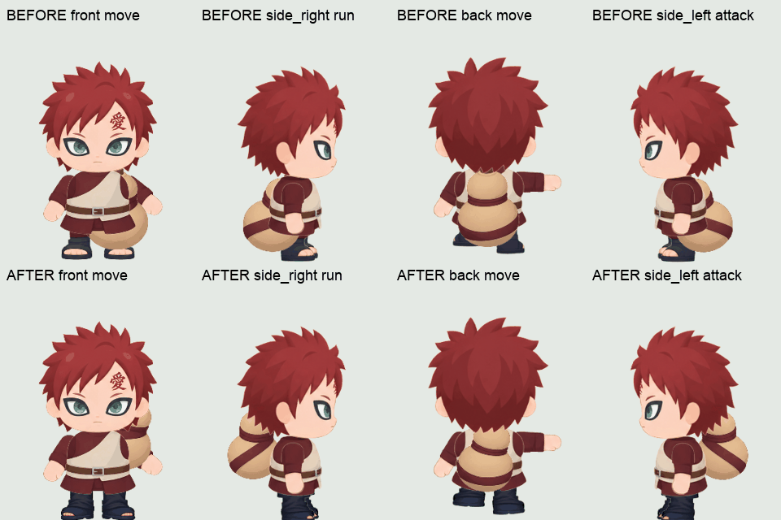
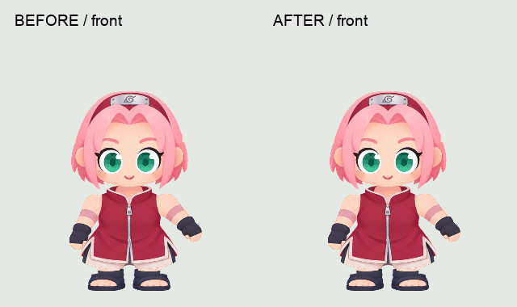

# 사스케·가아라·사쿠라 에셋 재생성

2026-10-30, [캐릭터 제작 가이드](../../CHARACTER-CREATION.md)의 흐름에 따라 기본 47종을 비교하고 어울리는 원형을 골라 이미지 파츠를 다시 생성했습니다. 게임에서 사용하는 세 캐릭터의 PNG·JSON 60쌍을 교체했습니다.

| 캐릭터 | 선택한 원형 | 선택 이유 |
| --- | --- | --- |
| 사스케 | `codmos_jet` | 날렵한 소년 비율, 짧은 머리와 분리된 팔다리 구조 |
| 가아라 | `br_bira` | 짧고 단단한 소년 체형, 겉옷을 적용하기 좋은 몸통 |
| 사쿠라 | `br_flora` | 사람형 얼굴과 튜닉에 어울리는 실루엣 |

## 제작 기록

원형에서 추출한 정면·측면·후면 파츠를 참고 이미지로 제공하고 기본 `image_gen` 도구로 새 파츠를 생성했습니다. 각 캐릭터 폴더의 `parts-reference.png`는 입력 참조, `generated-parts.png`는 생성 원본입니다. [실제 프롬프트](generation-prompts.json)를 함께 보관합니다.

생성된 파츠를 분리하고 투명 영역의 잔여 픽셀을 정리한 뒤, 원본 atlas 복사본의 기존 region에 맞춰 배치했습니다. 머리는 원본 메시의 UV 외곽에 맞췄습니다. 기본 뼈대·기존 attachment 데이터는 원본과 비교해 유지 여부를 확인했습니다. 최초 출력에서는 애니메이션도 유지했지만, 아래 사스케 팔 수정과 가아라 다리 수정에서 일부 팔다리 키프레임을 조정했습니다.

- 가아라: 생성한 호리병을 원본 몸 뼈대에 연결하는 region attachment를 추가하고, 추가 slot에 맞춰 그리기 순서를 조정했습니다.
- 사쿠라: 새 머리에 단발 머리카락이 포함되어, 선택한 스킨의 기존 추가 금발 region을 투명하게 처리했습니다.
- 정지·이동·공격·방어·실패 동작 등을 실제 Spine 런타임으로 재생한 뒤 24fps, 원본 scale 0.4로 출력했습니다. 프레임 사각형·재생 시간·Spine 루트 anchor를 JSON에 기록했습니다.

이 폴더는 제작 참조와 검증 기록입니다. 전체 방향별 Spine 제작 원본과 exporter 실행 환경을 제공하는 패키지는 아닙니다. 게임은 `public/survival/character-sprites/{sasuke,gaara,sakura}`의 출력 파일을 사용합니다.

## 검증

- `npm run check:character -- sasuke`, `gaara`, `sakura`: 각각 필수 PNG·JSON 20쌍 통과
- 원본 비교: 9개 방향별 리그의 뼈대·기존 attachment 유지. 사스케 팔 및 가아라 측면 다리 키프레임은 아래 수정 기록 참고
- 실제 게임: 세 캐릭터 각각 선택 후 상하좌우 이동 클립 확인, 실행 오류 없음
- `npm test`, `npm run build`: 통과

[검증 기록](runtime-qa.json), [게임용 파일 해시 목록](../../../public/survival/character-sprites/REGENERATED-NINJA-20261030.json)

## 사스케 팔 정밀 검토 및 수정 (2026-10-30)

몸통 그림에 팔 일부가 중복되어 있고, 새 팔 윤곽이 원본 메시 외곽에서 벗어나 있었습니다. 또한 원본 공격·방어 애니메이션에서 팔꿈치가 최대 150도 회전하고 팔이 늘어나는 구간에 메시 삼각형이 뒤집혔습니다.

몸통·팔 9개 파츠를 다시 생성하고 각 파츠를 원본 알파 윤곽에 맞춰 등록했습니다. 사스케 공격·방어에서만 팔꿈치 회전을 ±45도로 제한하고 팔 scale 트랙을 제거했습니다. 원본 뼈대, 메시 UV, 공격 0.85초·방어 1.2초의 재생 시간은 유지했습니다.

정면·측면·후면의 15개 원본 동작을 각각 241시점에서 검사했으며 팔 메시 뒤집힘은 0건입니다. 좌우 반전까지 포함한 게임용 20개 클립을 다시 출력했고 모든 프레임의 잘림 검사를 통과했습니다.

- [9개 파츠 참조](sasuke-arm-fix/original-body-arms-reference.png), [생성 원본](sasuke-arm-fix/generated-body-arms-fix.png), [생성 프롬프트](sasuke-arm-fix/generation-prompt.json)
- [알파 정합 검사](sasuke-arm-fix/alpha-registration-report.json), [메시 검사](sasuke-arm-fix/mesh-validation.json), [팔 애니메이션 변경 전후](sasuke-arm-fix/animation-bone-patches.json)

위쪽의 세 캐릭터 통합 미리보기는 최초 출력 기록이며, 사스케의 최신 출력은 이 수정 전후 비교와 게임용 파일을 기준으로 합니다.

## 가아라 호리병·다리 정밀 검토 및 수정 (2026-10-30)

호리병이 엉덩이 높이에 있어 다리를 가리고, 다리 윗부분의 붉은 파츠가 몸통 옷자락과 겹쳐 있었습니다. 측면 원본 다리 메시에서는 발 관절 회전 중 삼각형 뒤집힘도 확인했습니다.

- 호리병은 기존 그림과 body 뼈대 연결을 유지하고, 정면·측면·후면마다 높이·거리·기울기·크기를 조정했습니다. 발과 다리를 가리던 아래쪽 겹침을 줄였습니다.
- 다리 6개를 기본 `image_gen` 도구로 다시 생성했습니다. 붉은 옷자락 대신 짙은 바지와 샌들로 연결하고 원본 알파 윤곽에 맞췄습니다.
- 가아라 측면의 `leg_l2`, `leg_r2` 회전 키프레임만 ±5도로 제한했습니다. 뼈대·메시 UV·고관절 움직임·클립 재생 시간은 유지했습니다.
- 15개 방향별 동작을 각각 241시점에서 검사해 다리 메시 뒤집힘 0건을 확인했습니다. 좌우 반전 포함 게임용 20개 클립의 프레임 경계·anchor·재생 시간 검사를 통과했습니다.

[파츠 참조](gaara-rig-fix/original-legs-reference.png), [생성 원본](gaara-rig-fix/generated-legs-fix.png), [실제 프롬프트](gaara-rig-fix/generation-prompt.json), [알파 검사](gaara-rig-fix/alpha-registration-report.json), [메시 검사](gaara-rig-fix/mesh-validation.json), [리그 변경 전후](gaara-rig-fix/rig-patches.json), [게임 내 검증](gaara-rig-fix/game-qa.json)

위쪽의 최초 통합 미리보기 대신 이 비교 이미지와 게임용 파일을 가아라의 최신 상태로 봐 주세요.

## 사쿠라 뒷머리 크기·위치 수정 (2026-10-30)

정지 시 실제 출력된 머리 폭은 정면 145px, 측면 145px, 후면 226px였습니다. 후면 region attachment가 앞·옆모습보다 크게 배치되어 방향을 바꿀 때 머리가 갑자기 커 보였습니다.

기존 머리 그림을 유지하고 후면 `br_flora/head/head` attachment만 가로·세로 같은 비율 0.65로 줄였습니다. 목 기준 위치를 맞추기 위해 로컬 x를 30만큼 올렸습니다. 수정 후 후면 폭은 147px, 높이는 127px이며 정면 높이 122px·측면 높이 127px와 비슷합니다.

후면 대기·이동·공격·방어 PNG·JSON 4쌍을 다시 출력했습니다. 원본 그림·뼈대·애니메이션·나머지 16개 클립은 유지했습니다. 게임에서 앞→오른쪽→뒤→왼쪽→뒤→앞 이동 전환을 확인했고, 캐릭터 패키지 검사와 빌드를 통과했습니다.

[머리 크기 측정](sakura-head-fix/head-size-qa.json), [attachment 변경 전후](sakura-head-fix/attachment-patch.json), [게임 내 검증](sakura-head-fix/game-qa.json). 위쪽의 최초 통합 미리보기 대신 이 비교와 게임용 파일을 사쿠라의 최신 상태로 봐 주세요.
