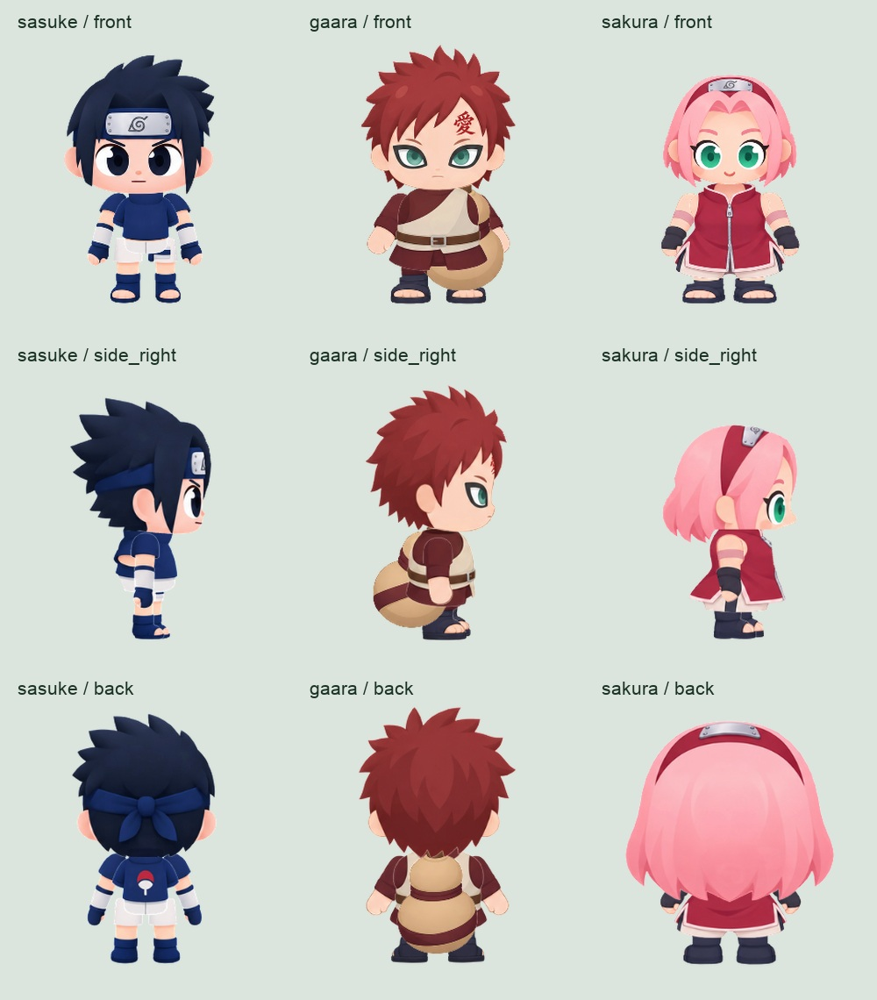
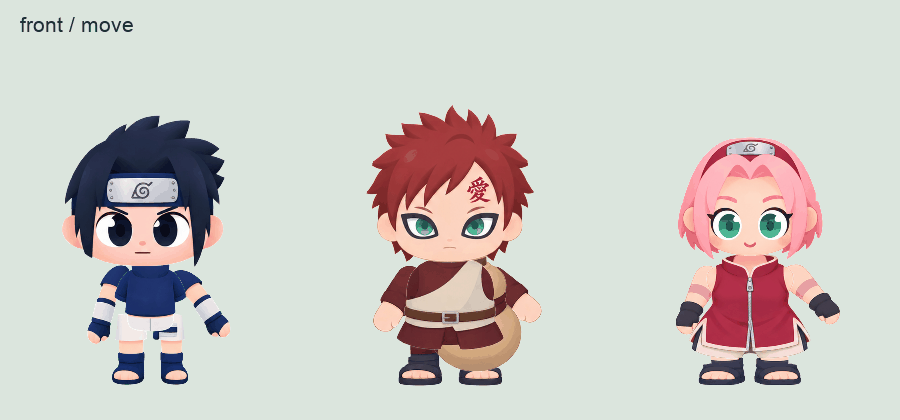

# 사스케·가아라·사쿠라 에셋 재생성

2026-10-30, [캐릭터 제작 가이드](../../CHARACTER-CREATION.md)의 흐름에 따라 기본 47종을 비교하고 어울리는 원형을 골라 이미지 파츠를 다시 생성했습니다. 게임에서 사용하는 세 캐릭터의 PNG·JSON 60쌍을 교체했습니다.

| 캐릭터 | 선택한 원형 | 선택 이유 |
| --- | --- | --- |
| 사스케 | `codmos_jet` | 날렵한 소년 비율, 짧은 머리와 분리된 팔다리 구조 |
| 가아라 | `br_bira` | 짧고 단단한 소년 체형, 겉옷을 적용하기 좋은 몸통 |
| 사쿠라 | `br_flora` | 사람형 얼굴과 튜닉에 어울리는 실루엣 |

## 제작 기록

원형에서 추출한 정면·측면·후면 파츠를 참고 이미지로 제공하고 기본 `image_gen` 도구로 새 파츠를 생성했습니다. 각 캐릭터 폴더의 `parts-reference.png`는 입력 참조, `generated-parts.png`는 생성 원본입니다. [실제 프롬프트](generation-prompts.json)를 함께 보관합니다.

생성된 파츠를 분리하고 투명 영역의 잔여 픽셀을 정리한 뒤, 원본 atlas 복사본의 기존 region에 맞춰 배치했습니다. 머리는 원본 메시의 UV 외곽에 맞췄습니다. 기본 뼈대·기존 attachment 데이터·뼈대 애니메이션 키프레임은 원본과 비교해 유지 여부를 확인했습니다.

- 가아라: 생성한 호리병을 원본 몸 뼈대에 연결하는 region attachment를 추가하고, 추가 slot에 맞춰 그리기 순서를 조정했습니다.
- 사쿠라: 새 머리에 단발 머리카락이 포함되어, 선택한 스킨의 기존 추가 금발 region을 투명하게 처리했습니다.
- 정지·이동·공격·방어·실패 동작 등을 실제 Spine 런타임으로 재생한 뒤 24fps, 원본 scale 0.4로 출력했습니다. 프레임 사각형·재생 시간·Spine 루트 anchor를 JSON에 기록했습니다.

이 폴더는 제작 참조와 검증 기록입니다. 전체 방향별 Spine 제작 원본과 exporter 실행 환경을 제공하는 패키지는 아닙니다. 게임은 `public/survival/character-sprites/{sasuke,gaara,sakura}`의 출력 파일을 사용합니다.

## 검증

- `npm run check:character -- sasuke`, `gaara`, `sakura`: 각각 필수 PNG·JSON 20쌍 통과
- 원본 비교: 9개 방향별 리그의 뼈대·기존 attachment·뼈대 애니메이션 키프레임 유지
- 실제 게임: 세 캐릭터 각각 선택 후 상하좌우 이동 클립 확인, 실행 오류 없음
- `npm test`, `npm run build`: 통과

[검증 기록](runtime-qa.json), [게임용 파일 해시 목록](../../../public/survival/character-sprites/REGENERATED-NINJA-20261030.json)
